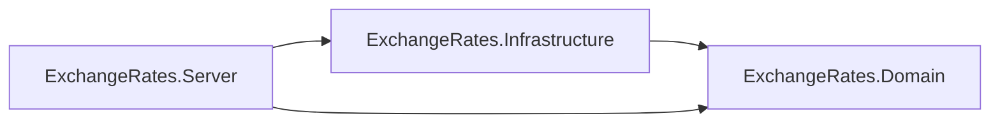

# Dependency Diagram

Generated: 2026-09-24 16:42:06

Solution: `ExchangeRates.Server.slnx`

## Project Dependencies



## Types

```mermaid
classDiagram

namespace ExchangeRates_Domain {
    class ExchangeRates_Domain_Entities_CentralBankEntity {
        +NativeCurrencyCode : string
        +Id : int
        +BankCode : string
        +BankName : string
        +CountryOfOrigin : string
        +ApiUrl : string
        +CurrencyId : int
        +IsActive : bool
        +CreatedAtUtc : DateTime
        +Priority : int?
        +NativeCurrency : CurrencyEntity
        +SupportedCurrencies : ICollection~CentralBankSupportedCurrencyEntity~
        +CentralBankEntity()
        +CentralBankEntity(string bankCode, string bankName, string countryOfOrigin, int nativeCurrencyId, bool isActive, DateTime createdAtUtc)
    }
    class ExchangeRates_Domain_Entities_CentralBankSupportedCurrencyEntity {
        +CentralBankId : int
        +CurrencyId : int
        +ProviderSeriesId : string?
        +CentralBank : CentralBankEntity
        +Currency : CurrencyEntity
    }
    class ExchangeRates_Domain_Entities_CurrencyEntity {
        +Id : int
        +CurrencyCode : string
        +NumericCode : short
        +Name : string
        +IsHistoric : bool
        +Priority : int
        +SupportedByCentralBanks : ICollection~CentralBankSupportedCurrencyEntity~
        +CurrencyEntity()
        +CurrencyEntity(int id)
        +CurrencyEntity(string currencyCode)
        +CurrencyEntity(string currencyCode, short numericCode, string name, bool isHistoric, int priority)
    }
    class ExchangeRates_Domain_Entities_ExchangeRateEntity {
        +Id : long
        +Date : DateOnly
        +BaseCurrencyId : int
        +BaseCurrency : CurrencyEntity
        +QuoteCurrencyId : int
        +QuoteCurrency : CurrencyEntity
        +Rate : decimal
        +Provider : string
    }
    class ExchangeRates_Domain_Entities_ExchangeRateUnavailableDateEntity {
        +Id : long
        +CentralBankId : int
        +BaseCurrency : string
        +QuoteCurrency : string
        +UnavailableDate : DateOnly
        +CreatedAtUTC : DateTime
        +Reason : string?
    }
    class ExchangeRates_Domain_Entities_FixedExchangeRateEntity {
        +Id : int
        +CurrencyId : int
        +PeggedOnCurrencyId : int
        +Rate : decimal
        +IsActive : bool
        +Currency : CurrencyEntity
        +PeggedOnCurrency : CurrencyEntity
        +ValidFrom : DateOnly?
        +ValidTo : DateOnly?
    }
    class ExchangeRates_Domain_Entities_PreferredProviderEntity {
        +Id : int
        +CurrencyId : int
        +CentralBankId : int
        +Priority : int
        +IsActive : bool
        +CreatedAtUtc : DateTime
        +Currency : CurrencyEntity
        +CentralBank : CentralBankEntity
    }
    class ExchangeRates_Domain_Interfaces_ICentralBankProvider {
        <<interface>>
        ~HistoricCurrencies : List~string~
        ~PivotCurrency : string
        ~BankCode : string
        ~NativeCurrencyCode : string
        ~BankName : string
        ~CountryOfOrigin : string?
        ~Priority : int?
        ~SupportedCurrencies : IReadOnlySet~string~
        ~GetRatesAsync(string currency, DateOnly fromDate, DateOnly toDate, CancellationToken ct) Task~IReadOnlyList~ExchangeRateResult~~
        ~Supports(string currency) bool
    }
    class ExchangeRates_Domain_Interfaces_ICoinbaseMarketDataProvider {
        <<interface>>
    }
    class ExchangeRates_Domain_Interfaces_ICryptoMarketDataProvider {
        <<interface>>
        ~Name : string
        ~ConnectAsync(IEnumerable~string~ symbols, Func~CryptoPriceResult, Task~ onPriceReceived, CancellationToken ct) Task
    }
    class ExchangeRates_Domain_Interfaces_IExchangeRateRepository {
        <<interface>>
        ~GetRatesAsync(string baseCurrency, string quoteCurrency, DateOnly fromDate, DateOnly toDate, CancellationToken ct) Task~IReadOnlyList~ExchangeRateEntity~~
        ~AddRangeAsync(IEnumerable~ExchangeRateEntity~ rates, CancellationToken ct) Task~int~
        ~GetCurrenciesAsync(CancellationToken ct) Task~IReadOnlyList~CurrencyEntity~~
        ~GetCurrencyByCodesAsync(IEnumerable~string~ currencyCodes, CancellationToken ct) Task~IReadOnlyList~CurrencyEntity~~
        ~GetCentralBanksAsync(CancellationToken ct) Task~IEnumerable~CentralBankEntity~~
        ~GetCentralBankAsync(string bankCode, CancellationToken ct) Task~CentralBankEntity~
        ~FindSuitableBankAsync(string currency1, string currency2, CancellationToken ct, bool isHistoric1 = false, bool isHistoric2 = false) Task~CentralBankEntity~
        ~AddUnavailableDatesAsync(IEnumerable~ExchangeRateUnavailableDateEntity~ unavailableDates, CancellationToken ct) Task~int~
        ~GetUnavailableDateEntitiesAsync(DateOnly from, DateOnly to, CancellationToken ct) Task~HashSet~ExchangeRateUnavailableDateEntity~~
        ~GetUnavailableDatesAsync(DateOnly from, DateOnly to, CancellationToken ct) Task~HashSet~DateOnly~~
    }
    class ExchangeRates_Domain_Models_CentralBankModel {
        +BankCode : string
        +BankName : string
        +CountryOfOrigin : string
        +NativeCurrency : string
        +CurrencyId : int
        +IsActive : bool
        +Priority : int?
        +Currency : CurrencyEntity
        +CentralBankModel(string bankCode, string bankName, string countryOfOrigin, string nativeCurrency, int currencyId, int? priority)
    }
    class ExchangeRates_Domain_Models_CurrencyModel {
        +CurrencyCode : string
        +Name : string
        +IsHistoric : bool
        +NumericCode : int
        +CurrencyModel(string currencyCode, int numericCode, string name, bool isHistoric)
    }
    class ExchangeRates_Domain_Utilities_CustomDateTimeConverter {
        +Read(ref Utf8JsonReader reader, Type typeToConvert, JsonSerializerOptions options) DateTime
        ~JsonException($'Invalid DateTime: (value)') throw new
        +Write(Utf8JsonWriter writer, DateTime value, JsonSerializerOptions options) void
    }
    class ExchangeRates_Domain_Utilities_DateRangeHelper {
        +GetMissingDates(DateOnly fromDate, DateOnly toDate, IEnumerable~DateOnly~ existingDates) IReadOnlyList~DateOnly~
    }
    class ExchangeRates_Domain_Utilities_TextUtils {
        +SplitCsv(string line) List~string~
        ~if(ch == ',' && !quoted) else
    }
    class ExchangeRates_Server_Enums_ECentralBankProvider {
        <<enumeration>>
    }
}

namespace ExchangeRates_Infrastructure {
    class BDIProvider {
        +BDIProvider(HttpClient http, IConfiguration configuration, CentralBankEntity bank, ILogger~BDIProvider~ logger)
        #FetchAsync(string quoteCurrency, DateOnly fromDate, DateOnly toDate, CancellationToken ct) Task~IReadOnlyList~ExchangeRateResult~~
        ~ArgumentException('fromDate cannot be greater than toDate.') throw new
    }
    class NBUProvider {
        +NBUProvider(HttpClient http, IConfiguration configuration, CentralBankEntity bank, ILogger~NBUProvider~ logger)
        #FetchAsync(string currency, DateOnly fromDate, DateOnly toDate, CancellationToken ct) Task~IReadOnlyList~ExchangeRateResult~~
    }
    class ExchangeRates_Domain_Interfaces_CoinbaseMarketDataProvider {
        +Name : string
        +ConnectAsync(IEnumerable~string~ symbols, Func~CryptoPriceResult, Task~ onPriceReceived, CancellationToken ct) Task
        ~NotImplementedException() throw new
    }
    class ExchangeRates_Infrastructure_ExchangeRatesDbContext {
        +ExchangeRates : DbSet~ExchangeRateEntity~
        +Currencies : DbSet~CurrencyEntity~
        +CentralBanks : DbSet~CentralBankEntity~
        +FixedExchangeRates : DbSet~FixedExchangeRateEntity~
        +CentralBankSupportedCurrencies : DbSet~CentralBankSupportedCurrencyEntity~
        +ExchangeRateUnavailableDates : DbSet~ExchangeRateUnavailableDateEntity~
        +PreferredProviders : DbSet~PreferredProviderEntity~
        +ExchangeRatesDbContext(DbContextOptions~ExchangeRatesDbContext~ options)
        #OnModelCreating(ModelBuilder modelBuilder) void
    }
    class ExchangeRates_Infrastructure_Migrations_AddExchangeRateFetch {
        #Up(MigrationBuilder migrationBuilder) void
        #Down(MigrationBuilder migrationBuilder) void
    }
    class ExchangeRates_Infrastructure_Migrations_ExchangeRatesDbContextModelSnapshot {
        #BuildModel(ModelBuilder modelBuilder) void
    }
    class ExchangeRates_Infrastructure_Migrations_InitialCreate {
        #Up(MigrationBuilder migrationBuilder) void
        #Down(MigrationBuilder migrationBuilder) void
    }
    class ExchangeRates_Infrastructure_Migrations_RemoveProviderColumnFix {
        #Up(MigrationBuilder migrationBuilder) void
        #Down(MigrationBuilder migrationBuilder) void
    }
    class ExchangeRates_Infrastructure_Providers_AFAProvider {
        +AFAProvider(HttpClient http, IConfiguration configuration, CentralBankEntity bank, ILogger~AFAProvider~ logger)
        #FetchAsync(string quoteCurrency, DateOnly fromDate, DateOnly toDate, CancellationToken ct) Task~IReadOnlyList~ExchangeRateResult~~
    }
    class ExchangeRates_Infrastructure_Providers_AMCMProvider {
        +AMCMProvider(HttpClient http, IConfiguration configuration, CentralBankEntity bank, ILogger~AMCMProvider~ logger)
        #FetchAsync(string quoteCurrency, DateOnly fromDate, DateOnly toDate, CancellationToken ct) Task~IReadOnlyList~ExchangeRateResult~~
    }
    class ExchangeRates_Infrastructure_Providers_BAMProvider {
        +BAMProvider(HttpClient http, IConfiguration configuration, CentralBankEntity bank, ILogger~BAMProvider~ logger)
        #FetchAsync(string quoteCurrency, DateOnly fromDate, DateOnly toDate, CancellationToken ct) Task~IReadOnlyList~ExchangeRateResult~~
        ~InvalidOperationException('Missing CentralBanks:BAM:ApiKey.') throw new
    }
    class ExchangeRates_Infrastructure_Providers_BANREPProvider {
        +BANREPProvider(HttpClient http, IConfiguration configuration, CentralBankEntity bank, ILogger~BANREPProvider~ logger)
        #FetchAsync(string quoteCurrency, DateOnly fromDate, DateOnly toDate, CancellationToken ct) Task~IReadOnlyList~ExchangeRateResult~~
    }
    class ExchangeRates_Infrastructure_Providers_BANXICOProvider {
        ~seriesId : string
        +BANXICOProvider(HttpClient http, IConfiguration configuration, CentralBankEntity bank, ILogger~BANXICOProvider~ logger)
        #FetchAsync(string quoteCurrency, DateOnly fromDate, DateOnly toDate, CancellationToken ct) Task~IReadOnlyList~ExchangeRateResult~~
        ~InvalidOperationException('Missing CentralBanks:BANXICO:ApiKey.') throw new
    }
    class ExchangeRates_Infrastructure_Providers_BBKProvider {
        +BBKProvider(HttpClient http, IConfiguration configuration, CentralBankEntity bank, ILogger~BBKProvider~ logger)
        #FetchAsync(string quoteCurrency, DateOnly fromDate, DateOnly toDate, CancellationToken ct) Task~IReadOnlyList~ExchangeRateResult~~
    }
    class ExchangeRates_Infrastructure_Providers_BCBOProvider {
        +BCBOProvider(HttpClient http, IConfiguration configuration, CentralBankEntity bank, ILogger~BCBOProvider~ logger)
        #FetchAsync(string quoteCurrency, DateOnly fromDate, DateOnly toDate, CancellationToken ct) Task~IReadOnlyList~ExchangeRateResult~~
        ~FetchCurrentYearAsync(quoteCurrency, fromDate, toDate, ct) return await
    }
    class ExchangeRates_Infrastructure_Providers_BCBProvider {
        +BCBProvider(HttpClient http, IConfiguration configuration, CentralBankEntity bank, ILogger~BCBProvider~ logger)
        #FetchAsync(string quoteCurrency, DateOnly fromDate, DateOnly toDate, CancellationToken ct) Task~IReadOnlyList~ExchangeRateResult~~
    }
    class ExchangeRates_Infrastructure_Providers_BCCProvider {
        +BCCProvider(HttpClient http, IConfiguration configuration, CentralBankEntity bank, ILogger~BCCProvider~ logger)
        #FetchAsync(string quoteCurrency, DateOnly fromDate, DateOnly toDate, CancellationToken ct) Task~IReadOnlyList~ExchangeRateResult~~
    }
    class ExchangeRates_Infrastructure_Providers_BCCRProvider {
        ~indicator : int
        +BCCRProvider(HttpClient http, IConfiguration configuration, CentralBankEntity bank, ILogger~BCCRProvider~ logger)
        #FetchAsync(string quoteCurrency, DateOnly fromDate, DateOnly toDate, CancellationToken ct) Task~IReadOnlyList~ExchangeRateResult~~
    }
    class ExchangeRates_Infrastructure_Providers_BCEAOProvider {
        +BCEAOProvider(HttpClient http, IConfiguration configuration, CentralBankEntity bank, ILogger~BCEAOProvider~ logger)
        #FetchAsync(string quoteCurrency, DateOnly fromDate, DateOnly toDate, CancellationToken ct) Task~IReadOnlyList~ExchangeRateResult~~
    }
    class ExchangeRates_Infrastructure_Providers_BCNProvider {
        +BCNProvider(HttpClient http, IConfiguration configuration, CentralBankEntity bank, ILogger~BCNProvider~ logger)
        #FetchAsync(string quoteCurrency, DateOnly fromDate, DateOnly toDate, CancellationToken ct) Task~IReadOnlyList~ExchangeRateResult~~
    }
    class ExchangeRates_Infrastructure_Providers_BCPProvider {
        +BCPProvider(HttpClient http, IConfiguration configuration, CentralBankEntity bank, ILogger~BCPProvider~ logger)
        #FetchAsync(string quoteCurrency, DateOnly fromDate, DateOnly toDate, CancellationToken ct) Task~IReadOnlyList~ExchangeRateResult~~
    }
    class ExchangeRates_Infrastructure_Providers_BCRAProvider {
        +BCRAProvider(HttpClient http, IConfiguration configuration, CentralBankEntity bank, ILogger~BCRAProvider~ logger)
        #FetchAsync(string quoteCurrency, DateOnly fromDate, DateOnly toDate, CancellationToken ct) Task~IReadOnlyList~ExchangeRateResult~~
    }
    class ExchangeRates_Infrastructure_Providers_BCTProvider {
        +BCTProvider(HttpClient http, IConfiguration configuration, CentralBankEntity bank, ILogger~BCTProvider~ logger)
        #FetchAsync(string quoteCurrency, DateOnly fromDate, DateOnly toDate, CancellationToken ct) Task~IReadOnlyList~ExchangeRateResult~~
    }
    class ExchangeRates_Infrastructure_Providers_BCUProvider {
        +BCUProvider(HttpClient http, IConfiguration configuration, CentralBankEntity bank, ILogger~BCUProvider~ logger)
        #FetchAsync(string quoteCurrency, DateOnly fromDate, DateOnly toDate, CancellationToken ct) Task~IReadOnlyList~ExchangeRateResult~~
    }
    class ExchangeRates_Infrastructure_Providers_BDPProvider {
        +BDPProvider(HttpClient http, IConfiguration configuration, CentralBankEntity bank, ILogger~BDPProvider~ logger)
        #FetchAsync(string quoteCurrency, DateOnly fromDate, DateOnly toDate, CancellationToken ct) Task~IReadOnlyList~ExchangeRateResult~~
    }
    class ExchangeRates_Infrastructure_Providers_BIProvider {
        +BIProvider(HttpClient http, IConfiguration configuration, CentralBankEntity bank, ILogger~BIProvider~ logger)
        #FetchAsync(string quoteCurrency, DateOnly fromDate, DateOnly toDate, CancellationToken ct) Task~IReadOnlyList~ExchangeRateResult~~
    }
    class ExchangeRates_Infrastructure_Providers_BNAProvider {
        +BNAProvider(HttpClient http, IConfiguration configuration, CentralBankEntity bank, ILogger~BNAProvider~ logger)
        #FetchAsync(string quoteCurrency, DateOnly fromDate, DateOnly toDate, CancellationToken ct) Task~IReadOnlyList~ExchangeRateResult~~
    }
    class ExchangeRates_Infrastructure_Providers_BNMProvider {
        +BNMProvider(HttpClient http, IConfiguration configuration, CentralBankEntity bank, ILogger~BNMProvider~ logger)
        #FetchAsync(string quoteCurrency, DateOnly fromDate, DateOnly toDate, CancellationToken ct) Task~IReadOnlyList~ExchangeRateResult~~
        ~if(data.ValueKind == JsonValueKind.Object) else
    }
    class ExchangeRates_Infrastructure_Providers_BNRProvider {
        +BNRProvider(HttpClient http, IConfiguration configuration, CentralBankEntity bank, ILogger~BNRProvider~ logger)
        #FetchAsync(string quoteCurrency, DateOnly fromDate, DateOnly toDate, CancellationToken ct) Task~IReadOnlyList~ExchangeRateResult~~
    }
    class ExchangeRates_Infrastructure_Providers_BNRRWProvider {
        +BNRRWProvider(HttpClient http, IConfiguration configuration, CentralBankEntity bank, ILogger~BNRRWProvider~ logger)
        #FetchAsync(string quoteCurrency, DateOnly fromDate, DateOnly toDate, CancellationToken ct) Task~IReadOnlyList~ExchangeRateResult~~
    }
    class ExchangeRates_Infrastructure_Providers_BOAProvider {
        +BOAProvider(HttpClient http, IConfiguration configuration, CentralBankEntity bank, ILogger~BOAProvider~ logger)
        #FetchAsync(string quoteCurrency, DateOnly fromDate, DateOnly toDate, CancellationToken ct) Task~IReadOnlyList~ExchangeRateResult~~
    }
    class ExchangeRates_Infrastructure_Providers_BOBProvider {
        +BOBProvider(HttpClient http, IConfiguration configuration, CentralBankEntity bank, ILogger~BOBProvider~ logger)
        #FetchAsync(string quoteCurrency, DateOnly fromDate, DateOnly toDate, CancellationToken ct) Task~IReadOnlyList~ExchangeRateResult~~
    }
    class ExchangeRates_Infrastructure_Providers_BOCProvider {
        +BOCProvider(HttpClient http, IConfiguration configuration, CentralBankEntity bank, ILogger~BOCProvider~ logger)
        #FetchAsync(string quoteCurrency, DateOnly fromDate, DateOnly toDate, CancellationToken ct) Task~IReadOnlyList~ExchangeRateResult~~
    }
    class ExchangeRates_Infrastructure_Providers_BOEProvider {
        +BOEProvider(HttpClient http, IConfiguration configuration, CentralBankEntity bank, ILogger~BOEProvider~ logger)
        #FetchAsync(string quoteCurrency, DateOnly fromDate, DateOnly toDate, CancellationToken ct) Task~IReadOnlyList~ExchangeRateResult~~
    }
    class ExchangeRates_Infrastructure_Providers_BOIProvider {
        +BOIProvider(HttpClient http, IConfiguration configuration, CentralBankEntity bank, ILogger~BOIProvider~ logger)
        #FetchAsync(string quoteCurrency, DateOnly fromDate, DateOnly toDate, CancellationToken ct) Task~IReadOnlyList~ExchangeRateResult~~
    }
    class ExchangeRates_Infrastructure_Providers_BOJAProvider {
        +BOJAProvider(HttpClient http, IConfiguration configuration, CentralBankEntity bank, ILogger~BOJAProvider~ logger)
        #FetchAsync(string quoteCurrency, DateOnly fromDate, DateOnly toDate, CancellationToken ct) Task~IReadOnlyList~ExchangeRateResult~~
    }
    class ExchangeRates_Infrastructure_Providers_BOJProvider {
        +BOJProvider(HttpClient http, IConfiguration configuration, CentralBankEntity bank, ILogger~BOJProvider~ logger)
        #FetchAsync(string quoteCurrency, DateOnly fromDate, DateOnly toDate, CancellationToken ct) Task~IReadOnlyList~ExchangeRateResult~~
    }
    class ExchangeRates_Infrastructure_Providers_BOKProvider {
        +BOKProvider(HttpClient http, IConfiguration configuration, CentralBankEntity bank, ILogger~BOKProvider~ logger)
        #FetchAsync(string quoteCurrency, DateOnly fromDate, DateOnly toDate, CancellationToken ct) Task~IReadOnlyList~ExchangeRateResult~~
        ~InvalidOperationException($'Missing CentralBanks:(Bank.NativeCurrency.CurrencyCode):ApiKey configuration.') throw new
    }
    class ExchangeRates_Infrastructure_Providers_BOMProvider {
        +BOMProvider(HttpClient http, IConfiguration configuration, CentralBankEntity bank, ILogger~BOMProvider~ logger)
        #FetchAsync(string quoteCurrency, DateOnly fromDate, DateOnly toDate, CancellationToken ct) Task~IReadOnlyList~ExchangeRateResult~~
    }
    class ExchangeRates_Infrastructure_Providers_BOTAProvider {
        +BOTAProvider(HttpClient http, IConfiguration configuration, CentralBankEntity bank, ILogger~BOTAProvider~ logger)
        #FetchAsync(string quoteCurrency, DateOnly fromDate, DateOnly toDate, CancellationToken ct) Task~IReadOnlyList~ExchangeRateResult~~
    }
    class ExchangeRates_Infrastructure_Providers_BOTProvider {
        +BOTProvider(HttpClient http, IConfiguration configuration, CentralBankEntity bank, ILogger~BOTProvider~ logger)
        #FetchAsync(string quoteCurrency, DateOnly fromDate, DateOnly toDate, CancellationToken ct) Task~IReadOnlyList~ExchangeRateResult~~
    }
    class ExchangeRates_Infrastructure_Providers_BRBProvider {
        +BRBProvider(HttpClient http, IConfiguration configuration, CentralBankEntity bank, ILogger~BRBProvider~ logger)
        #FetchAsync(string quoteCurrency, DateOnly fromDate, DateOnly toDate, CancellationToken ct) Task~IReadOnlyList~ExchangeRateResult~~
    }
    class ExchangeRates_Infrastructure_Providers_BSPProvider {
        +BSPProvider(HttpClient http, IConfiguration configuration, CentralBankEntity bank, ILogger~BSPProvider~ logger)
        #FetchAsync(string quoteCurrency, DateOnly fromDate, DateOnly toDate, CancellationToken ct) Task~IReadOnlyList~ExchangeRateResult~~
    }
    class ExchangeRates_Infrastructure_Providers_CBAProvider {
        +CBAProvider(HttpClient http, IConfiguration configuration, CentralBankEntity bank, ILogger~CBAProvider~ logger)
        #FetchAsync(string quoteCurrency, DateOnly fromDate, DateOnly toDate, CancellationToken ct) Task~IReadOnlyList~ExchangeRateResult~~
    }
    class ExchangeRates_Infrastructure_Providers_CBCProvider {
        +CBCProvider(HttpClient http, IConfiguration configuration, CentralBankEntity bank, ILogger~CBCProvider~ logger)
        #FetchAsync(string quoteCurrency, DateOnly fromDate, DateOnly toDate, CancellationToken ct) Task~IReadOnlyList~ExchangeRateResult~~
    }
    class ExchangeRates_Infrastructure_Providers_CBEProvider {
        +CBEProvider(HttpClient http, IConfiguration configuration, CentralBankEntity bank, ILogger~CBEProvider~ logger)
        #FetchAsync(string quoteCurrency, DateOnly fromDate, DateOnly toDate, CancellationToken ct) Task~IReadOnlyList~ExchangeRateResult~~
    }
    class ExchangeRates_Infrastructure_Providers_CBGProvider {
        +CBGProvider(HttpClient http, IConfiguration configuration, CentralBankEntity bank, ILogger~CBGProvider~ logger)
        #FetchAsync(string quoteCurrency, DateOnly fromDate, DateOnly toDate, CancellationToken ct) Task~IReadOnlyList~ExchangeRateResult~~
    }
    class ExchangeRates_Infrastructure_Providers_CBIProvider {
        +CBIProvider(HttpClient http, IConfiguration configuration, CentralBankEntity bank, ILogger~CBIProvider~ logger)
        #FetchAsync(string quoteCurrency, DateOnly fromDate, DateOnly toDate, CancellationToken ct) Task~IReadOnlyList~ExchangeRateResult~~
    }
    class ExchangeRates_Infrastructure_Providers_CBKProvider {
        +CBKProvider(HttpClient http, IConfiguration configuration, CentralBankEntity bank, ILogger~CBKProvider~ logger)
        #FetchAsync(string quoteCurrency, DateOnly fromDate, DateOnly toDate, CancellationToken ct) Task~IReadOnlyList~ExchangeRateResult~~
    }
    class ExchangeRates_Infrastructure_Providers_CBLLRProvider {
        +CBLLRProvider(HttpClient http, IConfiguration configuration, CentralBankEntity bank, ILogger~CBLLRProvider~ logger)
        #FetchAsync(string quoteCurrency, DateOnly fromDate, DateOnly toDate, CancellationToken ct) Task~IReadOnlyList~ExchangeRateResult~~
    }
    class ExchangeRates_Infrastructure_Providers_CBMProvider {
        +CBMProvider(HttpClient http, IConfiguration configuration, CentralBankEntity bank, ILogger~CBMProvider~ logger)
        #FetchAsync(string quoteCurrency, DateOnly fromDate, DateOnly toDate, CancellationToken ct) Task~IReadOnlyList~ExchangeRateResult~~
    }
    class ExchangeRates_Infrastructure_Providers_CBNProvider {
        +CBNProvider(HttpClient http, IConfiguration configuration, CentralBankEntity bank, ILogger~CBNProvider~ logger)
        #FetchAsync(string quoteCurrency, DateOnly fromDate, DateOnly toDate, CancellationToken ct) Task~IReadOnlyList~ExchangeRateResult~~
    }
    class ExchangeRates_Infrastructure_Providers_CBRProvider {
        +CBRProvider(HttpClient http, IConfiguration configuration, CentralBankEntity bank, ILogger~CBRProvider~ logger)
        #FetchAsync(string quoteCurrency, DateOnly fromDate, DateOnly toDate, CancellationToken ct) Task~IReadOnlyList~ExchangeRateResult~~
    }
    class ExchangeRates_Infrastructure_Providers_CBSLProvider {
        +CBSLProvider(HttpClient http, IConfiguration configuration, CentralBankEntity bank, ILogger~CBSLProvider~ logger)
        #FetchAsync(string quoteCurrency, DateOnly fromDate, DateOnly toDate, CancellationToken ct) Task~IReadOnlyList~ExchangeRateResult~~
    }
    class ExchangeRates_Infrastructure_Providers_CBSProvider {
        +CBSProvider(HttpClient http, IConfiguration configuration, CentralBankEntity bank, ILogger~CBSProvider~ logger)
        #FetchAsync(string quoteCurrency, DateOnly fromDate, DateOnly toDate, CancellationToken ct) Task~IReadOnlyList~ExchangeRateResult~~
    }
    class ExchangeRates_Infrastructure_Providers_CBUAEProvider {
        +CBUAEProvider(HttpClient http, IConfiguration configuration, CentralBankEntity bank, ILogger~CBUAEProvider~ logger)
        #FetchAsync(string quoteCurrency, DateOnly fromDate, DateOnly toDate, CancellationToken ct) Task~IReadOnlyList~ExchangeRateResult~~
        ~ExchangeRateResult(date, Bank.NativeCurrency.CurrencyCode, quoteCurrency, rate, Bank.BankCode) return new
    }
    class ExchangeRates_Infrastructure_Providers_CBUProvider {
        +CBUProvider(HttpClient http, IConfiguration configuration, CentralBankEntity bank, ILogger~CBUProvider~ logger)
        #FetchAsync(string quoteCurrency, DateOnly fromDate, DateOnly toDate, CancellationToken ct) Task~IReadOnlyList~ExchangeRateResult~~
    }
    class ExchangeRates_Infrastructure_Providers_CentralBankProviderBase {
        <<abstract>>
        +BankCode : string
        +NativeCurrencyCode : string
        +BankName : string
        +CountryOfOrigin : string?
        +Priority : int?
        #ApiUrl : string
        #HistoricalUrl : string?
        #ApiKey : string?
        +PivotCurrency : string
        +HistoricCurrencies : List~string~
        +SupportedCurrencies : IReadOnlySet~string~
        #Http : HttpClient
        #Configuration : IConfiguration
        #Bank : CentralBankEntity
        #CentralBankProviderBase(HttpClient http, CentralBankEntity bank, IConfiguration configuration)
        +Supports(string currency) bool
        +GetRatesAsync(string quoteCurrency, DateOnly fromDate, DateOnly toDate, CancellationToken ct) Task~IReadOnlyList~ExchangeRateResult~~
        ~FetchAsync(quoteCurrency, fromDate, toDate, ct) return
        #FetchAsync(string quoteCurrency, DateOnly fromDate, DateOnly toDate, CancellationToken ct) Task~IReadOnlyList~ExchangeRateResult~~
        #GetDecimal(JsonElement element, string propertyName) decimal
    }
    class ExchangeRates_Infrastructure_Providers_CentralBankProviderFactory {
        +CentralBankProviderFactory(IServiceProvider services, ILogger~CentralBankProviderFactory~ logger)
        +GetProvider(CentralBankEntity bank) ICentralBankProvider
        ~factory(bank) return
    }
    class ExchangeRates_Infrastructure_Providers_CNBProvider {
        +CNBProvider(HttpClient http, IConfiguration configuration, CentralBankEntity bank, ILogger~CNBProvider~ logger)
        #FetchAsync(string quoteCurrency, DateOnly fromDate, DateOnly toDate, CancellationToken ct) Task~IReadOnlyList~ExchangeRateResult~~
    }
    class ExchangeRates_Infrastructure_Providers_DABProvider {
        +DABProvider(HttpClient http, IConfiguration configuration, CentralBankEntity bank, ILogger~DABProvider~ logger)
        #FetchAsync(string quoteCurrency, DateOnly fromDate, DateOnly toDate, CancellationToken ct) Task~IReadOnlyList~ExchangeRateResult~~
    }
    class ExchangeRates_Infrastructure_Providers_DNBProvider {
        +DNBProvider(HttpClient http, IConfiguration configuration, CentralBankEntity bank, ILogger~DNBProvider~ logger)
        #FetchAsync(string quoteCurrency, DateOnly fromDate, DateOnly toDate, CancellationToken ct) Task~IReadOnlyList~ExchangeRateResult~~
    }
    class ExchangeRates_Infrastructure_Providers_ECBProvider {
        +ECBProvider(HttpClient http, IConfiguration configuration, CentralBankEntity bank, ILogger~ECBProvider~ logger)
        #FetchAsync(string quoteCurrency, DateOnly fromDate, DateOnly toDate, CancellationToken ct) Task~IReadOnlyList~ExchangeRateResult~~
        #FetchAsync_OLD(string quoteCurrency, DateOnly fromDate, DateOnly toDate, CancellationToken ct) Task~IReadOnlyList~ExchangeRateResult~~
    }
    class ExchangeRates_Infrastructure_Providers_FBILProvider {
        ~switch : return currencyPair
        +FBILProvider(HttpClient http, IConfiguration configuration, CentralBankEntity bank, ILogger~FBILProvider~ logger)
        #FetchAsync(string quoteCurrency, DateOnly fromDate, DateOnly toDate, CancellationToken ct) Task~IReadOnlyList~ExchangeRateResult~~
        ~ExtractTable(html, quoteCurrency, fromDate, toDate) return
    }
    class ExchangeRates_Infrastructure_Providers_FixedExchangeRateProvider {
        +FixedExchangeRateProvider(IConfiguration configuration)
        +TryGetFixedRate(string currency, out string peggedOn, out decimal rate) bool
    }
    class ExchangeRates_Infrastructure_Providers_FREDProvider {
        +FREDProvider(HttpClient http, IConfiguration configuration, CentralBankEntity bank, ILogger~FREDProvider~ logger)
        #FetchAsync(string quoteCurrency, DateOnly fromDate, DateOnly toDate, CancellationToken ct) Task~IReadOnlyList~ExchangeRateResult~~
        ~InvalidOperationException('FRED API key is not configured.') throw new
    }
    class ExchangeRates_Infrastructure_Providers_FREDProviderCurrencyConfiguration {
        +Currency : string
        +SeriesId : string
        +Invert : bool
    }
    class ExchangeRates_Infrastructure_Providers_HKMAProvider {
        +HKMAProvider(HttpClient http, IConfiguration configuration, CentralBankEntity bank, ILogger~HKMAProvider~ logger)
        #FetchAsync(string quoteCurrency, DateOnly fromDate, DateOnly toDate, CancellationToken ct) Task~IReadOnlyList~ExchangeRateResult~~
    }
    class ExchangeRates_Infrastructure_Providers_HNBProvider {
        +HNBProvider(HttpClient http, IConfiguration configuration, CentralBankEntity bank, ILogger~HNBProvider~ logger)
        #FetchAsync(string quoteCurrency, DateOnly fromDate, DateOnly toDate, CancellationToken ct) Task~IReadOnlyList~ExchangeRateResult~~
    }
    class ExchangeRates_Infrastructure_Providers_IMFProvider {
        ~context : string
        ~agencyID : string
        ~resourceID : string
        ~version : string
        ~indicator : string
        ~transformation : string
        ~frequency : string
        +IMFProvider(HttpClient http, IConfiguration configuration, CentralBankEntity bank, ILogger~IMFProvider~ logger)
        #FetchMQAsync(string quoteCurrency, DateOnly fromDate, DateOnly toDate, CancellationToken ct) Task~IReadOnlyList~ExchangeRateResult~~
        #FetchAsync(string quoteCurrency, DateOnly fromDate, DateOnly toDate, CancellationToken ct) Task~IReadOnlyList~ExchangeRateResult~~
    }
    class ExchangeRates_Infrastructure_Providers_LBProvider {
        +LBProvider(HttpClient http, IConfiguration configuration, CentralBankEntity bank, ILogger~LBProvider~ logger)
        #FetchAsync(string quoteCurrency, DateOnly fromDate, DateOnly toDate, CancellationToken ct) Task~IReadOnlyList~ExchangeRateResult~~
    }
    class ExchangeRates_Infrastructure_Providers_MASProvider {
        +MASProvider(HttpClient http, IConfiguration configuration, CentralBankEntity bank, ILogger~MASProvider~ logger)
        #FetchAsync(string quoteCurrency, DateOnly fromDate, DateOnly toDate, CancellationToken ct) Task~IReadOnlyList~ExchangeRateResult~~
    }
    class ExchangeRates_Infrastructure_Providers_MMAProvider {
        +MMAProvider(HttpClient http, IConfiguration configuration, CentralBankEntity bank, ILogger~MMAProvider~ logger)
        #FetchAsync(string quoteCurrency, DateOnly fromDate, DateOnly toDate, CancellationToken ct) Task~IReadOnlyList~ExchangeRateResult~~
    }
    class ExchangeRates_Infrastructure_Providers_MNBProvider {
        +MNBProvider(HttpClient http, IConfiguration configuration, CentralBankEntity bank, ILogger~MNBProvider~ logger)
        #FetchAsync(string quoteCurrency, DateOnly fromDate, DateOnly toDate, CancellationToken ct) Task~IReadOnlyList~ExchangeRateResult~~
    }
    class ExchangeRates_Infrastructure_Providers_NBCProvider {
        +NBCProvider(HttpClient http, IConfiguration configuration, CentralBankEntity bank, ILogger~NBCProvider~ logger)
        #FetchAsync(string quoteCurrency, DateOnly fromDate, DateOnly toDate, CancellationToken ct) Task~IReadOnlyList~ExchangeRateResult~~
    }
    class ExchangeRates_Infrastructure_Providers_NBEProvider {
        +NBEProvider(HttpClient http, IConfiguration configuration, CentralBankEntity bank, ILogger~NBEProvider~ logger)
        #FetchAsync(string quoteCurrency, DateOnly fromDate, DateOnly toDate, CancellationToken ct) Task~IReadOnlyList~ExchangeRateResult~~
    }
    class ExchangeRates_Infrastructure_Providers_NBGProvider {
        +NBGProvider(HttpClient http, IConfiguration configuration, CentralBankEntity bank, ILogger~NBGProvider~ logger)
        #FetchAsync(string quoteCurrency, DateOnly fromDate, DateOnly toDate, CancellationToken ct) Task~IReadOnlyList~ExchangeRateResult~~
    }
    class ExchangeRates_Infrastructure_Providers_NBKProvider {
        +NBKProvider(HttpClient http, IConfiguration configuration, CentralBankEntity bank, ILogger~NBKProvider~ logger)
        #FetchAsync(string quoteCurrency, DateOnly fromDate, DateOnly toDate, CancellationToken ct) Task~IReadOnlyList~ExchangeRateResult~~
    }
    class ExchangeRates_Infrastructure_Providers_NBKRProvider {
        +NBKRProvider(HttpClient http, IConfiguration configuration, CentralBankEntity bank, ILogger~NBKRProvider~ logger)
        #FetchAsync(string quoteCurrency, DateOnly fromDate, DateOnly toDate, CancellationToken ct) Task~IReadOnlyList~ExchangeRateResult~~
    }
    class ExchangeRates_Infrastructure_Providers_NBMProvider {
        +NBMProvider(HttpClient http, IConfiguration configuration, CentralBankEntity bank, ILogger~NBMProvider~ logger)
        #FetchAsync(string quoteCurrency, DateOnly fromDate, DateOnly toDate, CancellationToken ct) Task~IReadOnlyList~ExchangeRateResult~~
    }
    class ExchangeRates_Infrastructure_Providers_NBPProvider {
        +NBPProvider(HttpClient http, IConfiguration configuration, CentralBankEntity bank, ILogger~NBPProvider~ logger)
        #FetchAsync(string quoteCurrency, DateOnly fromDate, DateOnly toDate, CancellationToken ct) Task~IReadOnlyList~ExchangeRateResult~~
    }
    class ExchangeRates_Infrastructure_Providers_NBProvider {
        +NBProvider(HttpClient http, IConfiguration configuration, CentralBankEntity bank, ILogger~NBProvider~ logger)
        #FetchAsync(string quoteCurrency, DateOnly fromDate, DateOnly toDate, CancellationToken ct) Task~IReadOnlyList~ExchangeRateResult~~
    }
    class ExchangeRates_Infrastructure_Providers_NBRBProvider {
        +NBRBProvider(HttpClient http, IConfiguration configuration, CentralBankEntity bank, ILogger~NBRBProvider~ logger)
        #FetchAsync(string quoteCurrency, DateOnly fromDate, DateOnly toDate, CancellationToken ct) Task~IReadOnlyList~ExchangeRateResult~~
    }
    class ExchangeRates_Infrastructure_Providers_NBRMProvider {
        +NBRMProvider(HttpClient http, IConfiguration configuration, CentralBankEntity bank, ILogger~NBRMProvider~ logger)
        #FetchAsync(string quoteCurrency, DateOnly fromDate, DateOnly toDate, CancellationToken ct) Task~IReadOnlyList~ExchangeRateResult~~
    }
    class ExchangeRates_Infrastructure_Providers_NBTProvider {
        +NBTProvider(HttpClient http, IConfiguration configuration, CentralBankEntity bank, ILogger~NBTProvider~ logger)
        #FetchAsync(string quoteCurrency, DateOnly fromDate, DateOnly toDate, CancellationToken ct) Task~IReadOnlyList~ExchangeRateResult~~
    }
    class ExchangeRates_Infrastructure_Providers_NRBProvider {
        +NRBProvider(HttpClient http, IConfiguration configuration, CentralBankEntity bank, ILogger~NRBProvider~ logger)
        #FetchAsync(string quoteCurrency, DateOnly fromDate, DateOnly toDate, CancellationToken ct) Task~IReadOnlyList~ExchangeRateResult~~
    }
    class ExchangeRates_Infrastructure_Providers_NRBTProvider {
        +NRBTProvider(HttpClient http, IConfiguration configuration, CentralBankEntity bank, ILogger~NRBTProvider~ logger)
        #FetchAsync(string quoteCurrency, DateOnly fromDate, DateOnly toDate, CancellationToken ct) Task~IReadOnlyList~ExchangeRateResult~~
    }
    class ExchangeRates_Infrastructure_Providers_RBAProvider {
        +RBAProvider(HttpClient http, IConfiguration configuration, CentralBankEntity bank, ILogger~RBAProvider~ logger)
        #FetchAsync(string quoteCurrency, DateOnly fromDate, DateOnly toDate, CancellationToken ct) Task~IReadOnlyList~ExchangeRateResult~~
    }
    class ExchangeRates_Infrastructure_Providers_RBFProvider {
        +RBFProvider(HttpClient http, IConfiguration configuration, CentralBankEntity bank, ILogger~RBFProvider~ logger)
        #FetchAsync(string quoteCurrency, DateOnly fromDate, DateOnly toDate, CancellationToken ct) Task~IReadOnlyList~ExchangeRateResult~~
    }
    class ExchangeRates_Infrastructure_Providers_RBMProvider {
        +RBMProvider(HttpClient http, IConfiguration configuration, CentralBankEntity bank, ILogger~RBMProvider~ logger)
        #FetchAsync(string quoteCurrency, DateOnly fromDate, DateOnly toDate, CancellationToken ct) Task~IReadOnlyList~ExchangeRateResult~~
    }
    class ExchangeRates_Infrastructure_Providers_RBProvider {
        +RBProvider(HttpClient http, IConfiguration configuration, CentralBankEntity bank, ILogger~RBProvider~ logger)
        #FetchAsync(string quoteCurrency, DateOnly fromDate, DateOnly toDate, CancellationToken ct) Task~IReadOnlyList~ExchangeRateResult~~
    }
    class ExchangeRates_Infrastructure_Providers_RBVProvider {
        +RBVProvider(HttpClient http, IConfiguration configuration, CentralBankEntity bank, ILogger~RBVProvider~ logger)
        #FetchAsync(string quoteCurrency, DateOnly fromDate, DateOnly toDate, CancellationToken ct) Task~IReadOnlyList~ExchangeRateResult~~
    }
    class ExchangeRates_Infrastructure_Providers_SAMAProvider {
        +SAMAProvider(HttpClient http, IConfiguration configuration, CentralBankEntity bank, ILogger~SAMAProvider~ logger)
        #FetchAsync(string quoteCurrency, DateOnly fromDate, DateOnly toDate, CancellationToken ct) Task~IReadOnlyList~ExchangeRateResult~~
    }
    class ExchangeRates_Infrastructure_Providers_SARBProvider {
        +SARBProvider(HttpClient http, IConfiguration configuration, CentralBankEntity bank, ILogger~SARBProvider~ logger)
        #FetchAsync(string quoteCurrency, DateOnly fromDate, DateOnly toDate, CancellationToken ct) Task~IReadOnlyList~ExchangeRateResult~~
    }
    class ExchangeRates_Infrastructure_Providers_SBIProvider {
        +SBIProvider(HttpClient http, IConfiguration configuration, CentralBankEntity bank, ILogger~SBIProvider~ logger)
        #FetchAsync(string quoteCurrency, DateOnly fromDate, DateOnly toDate, CancellationToken ct) Task~IReadOnlyList~ExchangeRateResult~~
    }
    class ExchangeRates_Infrastructure_Providers_SBPProvider {
        +SBPProvider(HttpClient http, IConfiguration configuration, CentralBankEntity bank, ILogger~SBPProvider~ logger)
        #FetchAsync(string quoteCurrency, DateOnly fromDate, DateOnly toDate, CancellationToken ct) Task~IReadOnlyList~ExchangeRateResult~~
    }
    class ExchangeRates_Infrastructure_Providers_SNBProvider {
        +SNBProvider(HttpClient http, IConfiguration configuration, CentralBankEntity bank, ILogger~SNBProvider~ logger)
        #FetchAsync(string quoteCurrency, DateOnly fromDate, DateOnly toDate, CancellationToken ct) Task~IReadOnlyList~ExchangeRateResult~~
    }
    class ExchangeRates_Infrastructure_Providers_TCMBProvider {
        +TCMBProvider(HttpClient http, IConfiguration configuration, CentralBankEntity bank, ILogger~TCMBProvider~ logger)
        #FetchAsync(string quoteCurrency, DateOnly fromDate, DateOnly toDate, CancellationToken ct) Task~IReadOnlyList~ExchangeRateResult~~
    }
    class ExchangeRates_Infrastructure_Providers_Crypto_KrakenMarketDataProvider {
        +ConnectAsync(IEnumerable~string~ symbols, Func~CryptoPriceResult, Task~ onPriceReceived, CancellationToken ct) Task
        ~SubscribeAsync(socket, symbols, ct) await
        ~ReceiveAsync(socket, onPriceReceived, ct) await
        ~ProcessMessageAsync(json, onPriceReceived) await
        ~onPriceReceived(result) await
    }
    class ExchangeRates_Infrastructure_Repositories_ExchangeRateRepository {
        +ExchangeRateRepository(ExchangeRatesDbContext context, ILogger~ExchangeRateRepository~ logger)
        +GetRatesAsync(string baseCurrencyCode, string quoteCurrencyCode, DateOnly fromDate, DateOnly toDate, CancellationToken ct) Task~IReadOnlyList~ExchangeRateEntity~~
        +AddRangeAsync(IEnumerable~ExchangeRateEntity~ rates, CancellationToken ct) Task~int~
        +GetCurrenciesAsync(CancellationToken ct) Task~IReadOnlyList~CurrencyEntity~~
        +GetCurrencyByCodesAsync(IEnumerable~string~ codes, CancellationToken ct) Task~IReadOnlyList~CurrencyEntity~~
        +GetCentralBanksAsync(CancellationToken ct) Task~IEnumerable~CentralBankEntity~~
        +FindSuitableBankAsync(string currency1, string currency2, CancellationToken ct, bool isHistoric1 = false, bool isHistoric2 = false) Task~CentralBankEntity~
        ~InvalidOperationException($'No provider available for (currency1)/(currency2).') throw new
        +AddUnavailableDatesAsync(IEnumerable~ExchangeRateUnavailableDateEntity~ unavailableDates, CancellationToken ct) Task~int~
        +GetUnavailableDateEntitiesAsync(DateOnly from, DateOnly to, CancellationToken ct) Task~HashSet~ExchangeRateUnavailableDateEntity~~
        +GetUnavailableDatesAsync(DateOnly from, DateOnly to, CancellationToken ct) Task~HashSet~DateOnly~~
        +GetCentralBankAsync(string bankCode, CancellationToken ct) Task~CentralBankEntity~
        +GetPreferredProviderAsync(string providerCode, CancellationToken ct) Task~PreferredProviderEntity?~
    }
}

namespace ExchangeRates_Server {
    class ExchangeRates_Server_Program {
        +Main(string[] args) void
    }
    class ExchangeRates_Server_Configuration_CentralBankOptions {
        +Name : string
        +Url : string
        +Providers : Dictionary~string, CentralBankOptions~
    }
    class ExchangeRates_Server_Controllers_AppHealthController {
        +AppHealthController(IHealthStatusService healthCheckService, ILogger~AppHealthController~ logger)
        +GetHealthStatus(CancellationToken ct) Task~IActionResult~
        ~Ok(new ( isHealthy.CanConnect, isHealthy.LatencyMs, isHealthy.Error )) return
        ~StatusCode(503, new ( isHealthy.CanConnect, isHealthy.LatencyMs, isHealthy.Error )) return
        ~StatusCode(500, new ( CanConnect = false, LatencyMs = 0D, error = ex.Message )) return
    }
    class ExchangeRates_Server_Controllers_QuotesController {
        +QuotesController(IExchangeRateService service, IHealthStatusService healthCheckService, ILogger~QuotesController~ logger)
        +GetRates(string baseCurrency = 'jpy', string quoteCurrency = 'EUR', DateOnly? fromDate = null, DateOnly? toDate = null) Task~ActionResult~IReadOnlyList~ExchangeRateResult~~~
        ~Ok(result) return
        ~BadRequest(new ( error = ex.Message )) return
        +GetAvailableCurrencies(CancellationToken ct) Task~ActionResult~List~CurrencyModel~~~
        ~Ok(currencies) return
        +GetZacaMedia() ActionResult
        +GetEnvironment([FromServices] IWebHostEnvironment environment) IActionResult
        ~Ok(new ( environment = environment.EnvironmentName )) return
    }
    class ExchangeRates_Server_Interfaces_IExchangeRateService {
        <<interface>>
        ~GetRatesAsync(string quoteCurrency, string toCurrency, DateOnly fromDate, DateOnly toDate, CancellationToken ct = default) Task~IReadOnlyList~ExchangeRateResult~~
        ~GetCurrenciesAsync(CancellationToken ct = default) Task~IReadOnlyList~CurrencyModel~~
        ~GetCentralBanksAsync(CancellationToken ct = default) Task~IReadOnlyList~CentralBankModel~~
    }
    class ExchangeRates_Server_Interfaces_IHealthStatusService {
        <<interface>>
        ~GetDbHealthAsync(CancellationToken ct) Task~DbHealthResult~
    }
    class ExchangeRates_Server_Interfaces_IKrakenMarketDataService {
        <<interface>>
        ~ConnectAsync(CancellationToken ct) Task
    }
    class ExchangeRates_Server_Mappers_ExchangeRateMapper {
        ~ExchangeRateEntity : return new
        +ToEntity(this ExchangeRateResult result, int baseCurrencyId, int quoteCurrencyId) ExchangeRateEntity
        +ToResult(this ExchangeRateEntity entity) ExchangeRateResult
        ~ExchangeRateResult(entity.Date, entity.BaseCurrency.CurrencyCode, entity.QuoteCurrency.CurrencyCode, entity.Rate, entity.Provider) return new
    }
    class ExchangeRates_Server_Services_ExchangeRateService {
        +ExchangeRateService(ILogger~ExchangeRateService~ logger, IExchangeRateRepository repository, CentralBankProviderFactory providerFactory, IConfiguration configuration)
        +GetRatesAsync(string baseCurrency, string quoteCurrency, DateOnly fromDate, DateOnly toDate, CancellationToken ct) Task~IReadOnlyList~ExchangeRateResult~~
        ~ArgumentException('fromDate cannot be greater than toDate.') throw new
        ~GetTriangulatedRatesAsync(baseCurrency, quoteCurrency, fromDate, toDate, ct) return await
        ~OrientRates(rates, baseCurrency, quoteCurrency) return
        ~ExchangeRateResult(x.Date, baseCurrency, quoteCurrency, x.Rate * quoteRate.Rate, $'(x.Provider)+(quoteRate.Provider)') return new
        ~ExchangeRateResult(x.Date, baseCurrency, quoteCurrency, 1m / x.Rate, x.Provider) return new
        ~InvalidOperationException($'Rate (x.BaseCurrency)/(x.QuoteCurrency) cannot be oriented as (baseCurrency)/(quoteCurrency).') throw new
        ~ExchangeRateResult(x.Date, x.QuoteCurrency, x.BaseCurrency, 1m / x.Rate, x.Provider) return new
        +GetCurrenciesAsync(CancellationToken ct) Task~IReadOnlyList~CurrencyModel~~
        +GetCentralBanksAsync(CancellationToken ct) Task~IReadOnlyList~CentralBankModel~~
        ~NotImplementedException() throw new
        ~NotImplementedException() throw new
        ~NotImplementedException() throw new
    }
    class ExchangeRates_Server_Services_HealthStatusHub {
    }
    class ExchangeRates_Server_Services_HealthStatusService {
        +HealthStatusService(ILogger~HealthStatusService~ logger, ExchangeRatesDbContext context)
        +GetDbHealthAsync(CancellationToken ct) Task~DbHealthResult~
        ~DbHealthResult(true, stopwatch.Elapsed.TotalMilliseconds) return new
        ~DbHealthResult(false, 0, ex.Message) return new
    }
    class ExchangeRates_Server_Services_KrakenMarketDataService {
        +KrakenMarketDataService(ILogger~KrakenMarketDataService~ logger)
        +ConnectAsync(CancellationToken ct) Task
        ~SubscribeAsync(socket, ct) await
        ~ReceiveAsync(socket, ct) await
    }
    class ExchangeRates_Server_Workers_BitcoinPriceWorker {
        +BitcoinPriceWorker(ICryptoMarketDataProvider cryptoMarketDataProvider, ILogger~BitcoinPriceWorker~ logger)
        #ExecuteAsync(CancellationToken stoppingToken) Task
        ~UpdateBitcoinPriceAsync(stoppingToken) await
    }
    class ExchangeRates_Server_Workers_HealthStatusWorker {
        +HealthStatusWorker(IServiceScopeFactory scopeFactory, IHubContext~HealthStatusHub~ hubContext, ILogger~HealthStatusWorker~ logger)
        #ExecuteAsync(CancellationToken ct) Task
    }
}

ExchangeRates_Infrastructure_Providers_CentralBankProviderBase <|-- BDIProvider
BDIProvider ..> ExchangeRates_Domain_Entities_CentralBankEntity : injects
ExchangeRates_Domain_Entities_CentralBankEntity --> ExchangeRates_Domain_Entities_CurrencyEntity : NativeCurrency
ExchangeRates_Domain_Entities_CentralBankEntity --> ExchangeRates_Domain_Entities_CentralBankSupportedCurrencyEntity : SupportedCurrencies
ExchangeRates_Domain_Entities_CentralBankSupportedCurrencyEntity --> ExchangeRates_Domain_Entities_CentralBankEntity : CentralBank
ExchangeRates_Domain_Entities_CentralBankSupportedCurrencyEntity --> ExchangeRates_Domain_Entities_CurrencyEntity : Currency
ExchangeRates_Domain_Entities_CurrencyEntity --> ExchangeRates_Domain_Entities_CentralBankSupportedCurrencyEntity : SupportedByCentralBanks
ExchangeRates_Domain_Entities_ExchangeRateEntity --> ExchangeRates_Domain_Entities_CurrencyEntity : BaseCurrency
ExchangeRates_Domain_Entities_ExchangeRateEntity --> ExchangeRates_Domain_Entities_CurrencyEntity : QuoteCurrency
ExchangeRates_Domain_Entities_FixedExchangeRateEntity --> ExchangeRates_Domain_Entities_CurrencyEntity : Currency
ExchangeRates_Domain_Entities_FixedExchangeRateEntity --> ExchangeRates_Domain_Entities_CurrencyEntity : PeggedOnCurrency
ExchangeRates_Domain_Entities_PreferredProviderEntity --> ExchangeRates_Domain_Entities_CurrencyEntity : Currency
ExchangeRates_Domain_Entities_PreferredProviderEntity --> ExchangeRates_Domain_Entities_CentralBankEntity : CentralBank
ExchangeRates_Domain_Interfaces_ICryptoMarketDataProvider <|.. ExchangeRates_Domain_Interfaces_CoinbaseMarketDataProvider
ExchangeRates_Domain_Interfaces_IExchangeRateRepository ..> ExchangeRates_Domain_Entities_ExchangeRateEntity : returns
ExchangeRates_Domain_Interfaces_IExchangeRateRepository ..> ExchangeRates_Domain_Entities_ExchangeRateEntity : uses
ExchangeRates_Domain_Interfaces_IExchangeRateRepository ..> ExchangeRates_Domain_Entities_CurrencyEntity : returns
ExchangeRates_Domain_Interfaces_IExchangeRateRepository ..> ExchangeRates_Domain_Entities_CurrencyEntity : returns
ExchangeRates_Domain_Interfaces_IExchangeRateRepository ..> ExchangeRates_Domain_Entities_CentralBankEntity : returns
ExchangeRates_Domain_Interfaces_IExchangeRateRepository ..> ExchangeRates_Domain_Entities_CentralBankEntity : returns
ExchangeRates_Domain_Interfaces_IExchangeRateRepository ..> ExchangeRates_Domain_Entities_CentralBankEntity : returns
ExchangeRates_Domain_Interfaces_IExchangeRateRepository ..> ExchangeRates_Domain_Entities_ExchangeRateUnavailableDateEntity : uses
ExchangeRates_Domain_Interfaces_IExchangeRateRepository ..> ExchangeRates_Domain_Entities_ExchangeRateUnavailableDateEntity : returns
ExchangeRates_Domain_Models_CentralBankModel --> ExchangeRates_Domain_Entities_CurrencyEntity : Currency
ExchangeRates_Infrastructure_ExchangeRatesDbContext --> ExchangeRates_Domain_Entities_ExchangeRateEntity : ExchangeRates
ExchangeRates_Infrastructure_ExchangeRatesDbContext --> ExchangeRates_Domain_Entities_CurrencyEntity : Currencies
ExchangeRates_Infrastructure_ExchangeRatesDbContext --> ExchangeRates_Domain_Entities_CentralBankEntity : CentralBanks
ExchangeRates_Infrastructure_ExchangeRatesDbContext --> ExchangeRates_Domain_Entities_FixedExchangeRateEntity : FixedExchangeRates
ExchangeRates_Infrastructure_ExchangeRatesDbContext --> ExchangeRates_Domain_Entities_CentralBankSupportedCurrencyEntity : CentralBankSupportedCurrencies
ExchangeRates_Infrastructure_ExchangeRatesDbContext --> ExchangeRates_Domain_Entities_ExchangeRateUnavailableDateEntity : ExchangeRateUnavailableDates
ExchangeRates_Infrastructure_ExchangeRatesDbContext --> ExchangeRates_Domain_Entities_PreferredProviderEntity : PreferredProviders
ExchangeRates_Infrastructure_Providers_CentralBankProviderBase <|-- ExchangeRates_Infrastructure_Providers_AFAProvider
ExchangeRates_Infrastructure_Providers_AFAProvider ..> ExchangeRates_Domain_Entities_CentralBankEntity : injects
ExchangeRates_Infrastructure_Providers_CentralBankProviderBase <|-- ExchangeRates_Infrastructure_Providers_AMCMProvider
ExchangeRates_Infrastructure_Providers_AMCMProvider ..> ExchangeRates_Domain_Entities_CentralBankEntity : injects
ExchangeRates_Infrastructure_Providers_CentralBankProviderBase <|-- ExchangeRates_Infrastructure_Providers_BAMProvider
ExchangeRates_Infrastructure_Providers_BAMProvider ..> ExchangeRates_Domain_Entities_CentralBankEntity : injects
ExchangeRates_Infrastructure_Providers_CentralBankProviderBase <|-- ExchangeRates_Infrastructure_Providers_BANREPProvider
ExchangeRates_Infrastructure_Providers_BANREPProvider ..> ExchangeRates_Domain_Entities_CentralBankEntity : injects
ExchangeRates_Infrastructure_Providers_CentralBankProviderBase <|-- ExchangeRates_Infrastructure_Providers_BANXICOProvider
ExchangeRates_Infrastructure_Providers_BANXICOProvider ..> ExchangeRates_Domain_Entities_CentralBankEntity : injects
ExchangeRates_Infrastructure_Providers_CentralBankProviderBase <|-- ExchangeRates_Infrastructure_Providers_BBKProvider
ExchangeRates_Infrastructure_Providers_BBKProvider ..> ExchangeRates_Domain_Entities_CentralBankEntity : injects
ExchangeRates_Infrastructure_Providers_CentralBankProviderBase <|-- ExchangeRates_Infrastructure_Providers_BCBOProvider
ExchangeRates_Infrastructure_Providers_BCBOProvider ..> ExchangeRates_Domain_Entities_CentralBankEntity : injects
ExchangeRates_Infrastructure_Providers_CentralBankProviderBase <|-- ExchangeRates_Infrastructure_Providers_BCBProvider
ExchangeRates_Infrastructure_Providers_BCBProvider ..> ExchangeRates_Domain_Entities_CentralBankEntity : injects
ExchangeRates_Infrastructure_Providers_CentralBankProviderBase <|-- ExchangeRates_Infrastructure_Providers_BCCProvider
ExchangeRates_Infrastructure_Providers_BCCProvider ..> ExchangeRates_Domain_Entities_CentralBankEntity : injects
ExchangeRates_Infrastructure_Providers_CentralBankProviderBase <|-- ExchangeRates_Infrastructure_Providers_BCCRProvider
ExchangeRates_Infrastructure_Providers_BCCRProvider ..> ExchangeRates_Domain_Entities_CentralBankEntity : injects
ExchangeRates_Infrastructure_Providers_CentralBankProviderBase <|-- ExchangeRates_Infrastructure_Providers_BCEAOProvider
ExchangeRates_Infrastructure_Providers_BCEAOProvider ..> ExchangeRates_Domain_Entities_CentralBankEntity : injects
ExchangeRates_Infrastructure_Providers_CentralBankProviderBase <|-- ExchangeRates_Infrastructure_Providers_BCNProvider
ExchangeRates_Infrastructure_Providers_BCNProvider ..> ExchangeRates_Domain_Entities_CentralBankEntity : injects
ExchangeRates_Infrastructure_Providers_CentralBankProviderBase <|-- ExchangeRates_Infrastructure_Providers_BCPProvider
ExchangeRates_Infrastructure_Providers_BCPProvider ..> ExchangeRates_Domain_Entities_CentralBankEntity : injects
ExchangeRates_Infrastructure_Providers_CentralBankProviderBase <|-- ExchangeRates_Infrastructure_Providers_BCRAProvider
ExchangeRates_Infrastructure_Providers_BCRAProvider ..> ExchangeRates_Domain_Entities_CentralBankEntity : injects
ExchangeRates_Infrastructure_Providers_CentralBankProviderBase <|-- ExchangeRates_Infrastructure_Providers_BCTProvider
ExchangeRates_Infrastructure_Providers_BCTProvider ..> ExchangeRates_Domain_Entities_CentralBankEntity : injects
ExchangeRates_Infrastructure_Providers_CentralBankProviderBase <|-- ExchangeRates_Infrastructure_Providers_BCUProvider
ExchangeRates_Infrastructure_Providers_BCUProvider ..> ExchangeRates_Domain_Entities_CentralBankEntity : injects
ExchangeRates_Infrastructure_Providers_CentralBankProviderBase <|-- ExchangeRates_Infrastructure_Providers_BDPProvider
ExchangeRates_Infrastructure_Providers_BDPProvider ..> ExchangeRates_Domain_Entities_CentralBankEntity : injects
ExchangeRates_Infrastructure_Providers_CentralBankProviderBase <|-- ExchangeRates_Infrastructure_Providers_BIProvider
ExchangeRates_Infrastructure_Providers_BIProvider ..> ExchangeRates_Domain_Entities_CentralBankEntity : injects
ExchangeRates_Infrastructure_Providers_CentralBankProviderBase <|-- ExchangeRates_Infrastructure_Providers_BNAProvider
ExchangeRates_Infrastructure_Providers_BNAProvider ..> ExchangeRates_Domain_Entities_CentralBankEntity : injects
ExchangeRates_Infrastructure_Providers_CentralBankProviderBase <|-- ExchangeRates_Infrastructure_Providers_BNMProvider
ExchangeRates_Infrastructure_Providers_BNMProvider ..> ExchangeRates_Domain_Entities_CentralBankEntity : injects
ExchangeRates_Infrastructure_Providers_CentralBankProviderBase <|-- ExchangeRates_Infrastructure_Providers_BNRProvider
ExchangeRates_Infrastructure_Providers_BNRProvider ..> ExchangeRates_Domain_Entities_CentralBankEntity : injects
ExchangeRates_Infrastructure_Providers_CentralBankProviderBase <|-- ExchangeRates_Infrastructure_Providers_BNRRWProvider
ExchangeRates_Infrastructure_Providers_BNRRWProvider ..> ExchangeRates_Domain_Entities_CentralBankEntity : injects
ExchangeRates_Infrastructure_Providers_CentralBankProviderBase <|-- ExchangeRates_Infrastructure_Providers_BOAProvider
ExchangeRates_Infrastructure_Providers_BOAProvider ..> ExchangeRates_Domain_Entities_CentralBankEntity : injects
ExchangeRates_Infrastructure_Providers_CentralBankProviderBase <|-- ExchangeRates_Infrastructure_Providers_BOBProvider
ExchangeRates_Infrastructure_Providers_BOBProvider ..> ExchangeRates_Domain_Entities_CentralBankEntity : injects
ExchangeRates_Infrastructure_Providers_CentralBankProviderBase <|-- ExchangeRates_Infrastructure_Providers_BOCProvider
ExchangeRates_Infrastructure_Providers_BOCProvider ..> ExchangeRates_Domain_Entities_CentralBankEntity : injects
ExchangeRates_Infrastructure_Providers_CentralBankProviderBase <|-- ExchangeRates_Infrastructure_Providers_BOEProvider
ExchangeRates_Infrastructure_Providers_BOEProvider ..> ExchangeRates_Domain_Entities_CentralBankEntity : injects
ExchangeRates_Infrastructure_Providers_CentralBankProviderBase <|-- ExchangeRates_Infrastructure_Providers_BOIProvider
ExchangeRates_Infrastructure_Providers_BOIProvider ..> ExchangeRates_Domain_Entities_CentralBankEntity : injects
ExchangeRates_Infrastructure_Providers_CentralBankProviderBase <|-- ExchangeRates_Infrastructure_Providers_BOJAProvider
ExchangeRates_Infrastructure_Providers_BOJAProvider ..> ExchangeRates_Domain_Entities_CentralBankEntity : injects
ExchangeRates_Infrastructure_Providers_CentralBankProviderBase <|-- ExchangeRates_Infrastructure_Providers_BOJProvider
ExchangeRates_Infrastructure_Providers_BOJProvider ..> ExchangeRates_Domain_Entities_CentralBankEntity : injects
ExchangeRates_Infrastructure_Providers_CentralBankProviderBase <|-- ExchangeRates_Infrastructure_Providers_BOKProvider
ExchangeRates_Infrastructure_Providers_BOKProvider ..> ExchangeRates_Domain_Entities_CentralBankEntity : injects
ExchangeRates_Infrastructure_Providers_CentralBankProviderBase <|-- ExchangeRates_Infrastructure_Providers_BOMProvider
ExchangeRates_Infrastructure_Providers_BOMProvider ..> ExchangeRates_Domain_Entities_CentralBankEntity : injects
ExchangeRates_Infrastructure_Providers_CentralBankProviderBase <|-- ExchangeRates_Infrastructure_Providers_BOTAProvider
ExchangeRates_Infrastructure_Providers_BOTAProvider ..> ExchangeRates_Domain_Entities_CentralBankEntity : injects
ExchangeRates_Infrastructure_Providers_CentralBankProviderBase <|-- ExchangeRates_Infrastructure_Providers_BOTProvider
ExchangeRates_Infrastructure_Providers_BOTProvider ..> ExchangeRates_Domain_Entities_CentralBankEntity : injects
ExchangeRates_Infrastructure_Providers_CentralBankProviderBase <|-- ExchangeRates_Infrastructure_Providers_BRBProvider
ExchangeRates_Infrastructure_Providers_BRBProvider ..> ExchangeRates_Domain_Entities_CentralBankEntity : injects
ExchangeRates_Infrastructure_Providers_CentralBankProviderBase <|-- ExchangeRates_Infrastructure_Providers_BSPProvider
ExchangeRates_Infrastructure_Providers_BSPProvider ..> ExchangeRates_Domain_Entities_CentralBankEntity : injects
ExchangeRates_Infrastructure_Providers_CentralBankProviderBase <|-- ExchangeRates_Infrastructure_Providers_CBAProvider
ExchangeRates_Infrastructure_Providers_CBAProvider ..> ExchangeRates_Domain_Entities_CentralBankEntity : injects
ExchangeRates_Infrastructure_Providers_CentralBankProviderBase <|-- ExchangeRates_Infrastructure_Providers_CBCProvider
ExchangeRates_Infrastructure_Providers_CBCProvider ..> ExchangeRates_Domain_Entities_CentralBankEntity : injects
ExchangeRates_Infrastructure_Providers_CentralBankProviderBase <|-- ExchangeRates_Infrastructure_Providers_CBEProvider
ExchangeRates_Infrastructure_Providers_CBEProvider ..> ExchangeRates_Domain_Entities_CentralBankEntity : injects
ExchangeRates_Infrastructure_Providers_CentralBankProviderBase <|-- ExchangeRates_Infrastructure_Providers_CBGProvider
ExchangeRates_Infrastructure_Providers_CBGProvider ..> ExchangeRates_Domain_Entities_CentralBankEntity : injects
ExchangeRates_Infrastructure_Providers_CentralBankProviderBase <|-- ExchangeRates_Infrastructure_Providers_CBIProvider
ExchangeRates_Infrastructure_Providers_CBIProvider ..> ExchangeRates_Domain_Entities_CentralBankEntity : injects
ExchangeRates_Infrastructure_Providers_CentralBankProviderBase <|-- ExchangeRates_Infrastructure_Providers_CBKProvider
ExchangeRates_Infrastructure_Providers_CBKProvider ..> ExchangeRates_Domain_Entities_CentralBankEntity : injects
ExchangeRates_Infrastructure_Providers_CentralBankProviderBase <|-- ExchangeRates_Infrastructure_Providers_CBLLRProvider
ExchangeRates_Infrastructure_Providers_CBLLRProvider ..> ExchangeRates_Domain_Entities_CentralBankEntity : injects
ExchangeRates_Infrastructure_Providers_CentralBankProviderBase <|-- ExchangeRates_Infrastructure_Providers_CBMProvider
ExchangeRates_Infrastructure_Providers_CBMProvider ..> ExchangeRates_Domain_Entities_CentralBankEntity : injects
ExchangeRates_Infrastructure_Providers_CentralBankProviderBase <|-- ExchangeRates_Infrastructure_Providers_CBNProvider
ExchangeRates_Infrastructure_Providers_CBNProvider ..> ExchangeRates_Domain_Entities_CentralBankEntity : injects
ExchangeRates_Infrastructure_Providers_CentralBankProviderBase <|-- ExchangeRates_Infrastructure_Providers_CBRProvider
ExchangeRates_Infrastructure_Providers_CBRProvider ..> ExchangeRates_Domain_Entities_CentralBankEntity : injects
ExchangeRates_Infrastructure_Providers_CentralBankProviderBase <|-- ExchangeRates_Infrastructure_Providers_CBSLProvider
ExchangeRates_Infrastructure_Providers_CBSLProvider ..> ExchangeRates_Domain_Entities_CentralBankEntity : injects
ExchangeRates_Infrastructure_Providers_CentralBankProviderBase <|-- ExchangeRates_Infrastructure_Providers_CBSProvider
ExchangeRates_Infrastructure_Providers_CBSProvider ..> ExchangeRates_Domain_Entities_CentralBankEntity : injects
ExchangeRates_Infrastructure_Providers_CentralBankProviderBase <|-- ExchangeRates_Infrastructure_Providers_CBUAEProvider
ExchangeRates_Infrastructure_Providers_CBUAEProvider ..> ExchangeRates_Domain_Entities_CentralBankEntity : injects
ExchangeRates_Infrastructure_Providers_CentralBankProviderBase <|-- ExchangeRates_Infrastructure_Providers_CBUProvider
ExchangeRates_Infrastructure_Providers_CBUProvider ..> ExchangeRates_Domain_Entities_CentralBankEntity : injects
ExchangeRates_Domain_Interfaces_ICentralBankProvider <|.. ExchangeRates_Infrastructure_Providers_CentralBankProviderBase
ExchangeRates_Infrastructure_Providers_CentralBankProviderBase --> ExchangeRates_Domain_Entities_CentralBankEntity : Bank
ExchangeRates_Infrastructure_Providers_CentralBankProviderBase ..> ExchangeRates_Domain_Entities_CentralBankEntity : injects
ExchangeRates_Infrastructure_Providers_CentralBankProviderFactory --> ExchangeRates_Domain_Interfaces_ICentralBankProvider : _providerFactories
ExchangeRates_Infrastructure_Providers_CentralBankProviderFactory --> ExchangeRates_Domain_Entities_CentralBankEntity : _providerFactories
ExchangeRates_Infrastructure_Providers_CentralBankProviderFactory ..> ExchangeRates_Domain_Interfaces_ICentralBankProvider : returns
ExchangeRates_Infrastructure_Providers_CentralBankProviderFactory ..> ExchangeRates_Domain_Entities_CentralBankEntity : uses
ExchangeRates_Infrastructure_Providers_CentralBankProviderFactory ..> ExchangeRates_Domain_Interfaces_ICentralBankProvider : returns
ExchangeRates_Infrastructure_Providers_CentralBankProviderFactory ..> ExchangeRates_Domain_Entities_CentralBankEntity : returns
ExchangeRates_Infrastructure_Providers_CentralBankProviderBase <|-- ExchangeRates_Infrastructure_Providers_CNBProvider
ExchangeRates_Infrastructure_Providers_CNBProvider ..> ExchangeRates_Domain_Entities_CentralBankEntity : injects
ExchangeRates_Domain_Interfaces_ICryptoMarketDataProvider <|.. ExchangeRates_Infrastructure_Providers_Crypto_KrakenMarketDataProvider
ExchangeRates_Infrastructure_Providers_CentralBankProviderBase <|-- ExchangeRates_Infrastructure_Providers_DABProvider
ExchangeRates_Infrastructure_Providers_DABProvider ..> ExchangeRates_Domain_Entities_CentralBankEntity : injects
ExchangeRates_Infrastructure_Providers_CentralBankProviderBase <|-- ExchangeRates_Infrastructure_Providers_DNBProvider
ExchangeRates_Infrastructure_Providers_DNBProvider ..> ExchangeRates_Domain_Entities_CentralBankEntity : injects
ExchangeRates_Infrastructure_Providers_CentralBankProviderBase <|-- ExchangeRates_Infrastructure_Providers_ECBProvider
ExchangeRates_Infrastructure_Providers_ECBProvider ..> ExchangeRates_Domain_Entities_CentralBankEntity : injects
ExchangeRates_Infrastructure_Providers_CentralBankProviderBase <|-- ExchangeRates_Infrastructure_Providers_FBILProvider
ExchangeRates_Infrastructure_Providers_FBILProvider ..> ExchangeRates_Domain_Entities_CentralBankEntity : injects
ExchangeRates_Infrastructure_Providers_CentralBankProviderBase <|-- ExchangeRates_Infrastructure_Providers_FREDProvider
ExchangeRates_Infrastructure_Providers_FREDProvider --> ExchangeRates_Infrastructure_Providers_FREDProviderCurrencyConfiguration : Series
ExchangeRates_Infrastructure_Providers_FREDProvider ..> ExchangeRates_Domain_Entities_CentralBankEntity : injects
ExchangeRates_Infrastructure_Providers_CentralBankProviderBase <|-- ExchangeRates_Infrastructure_Providers_HKMAProvider
ExchangeRates_Infrastructure_Providers_HKMAProvider ..> ExchangeRates_Domain_Entities_CentralBankEntity : injects
ExchangeRates_Infrastructure_Providers_CentralBankProviderBase <|-- ExchangeRates_Infrastructure_Providers_HNBProvider
ExchangeRates_Infrastructure_Providers_HNBProvider ..> ExchangeRates_Domain_Entities_CentralBankEntity : injects
ExchangeRates_Infrastructure_Providers_CentralBankProviderBase <|-- ExchangeRates_Infrastructure_Providers_IMFProvider
ExchangeRates_Infrastructure_Providers_IMFProvider ..> ExchangeRates_Domain_Entities_CentralBankEntity : injects
ExchangeRates_Infrastructure_Providers_CentralBankProviderBase <|-- ExchangeRates_Infrastructure_Providers_LBProvider
ExchangeRates_Infrastructure_Providers_LBProvider ..> ExchangeRates_Domain_Entities_CentralBankEntity : injects
ExchangeRates_Infrastructure_Providers_CentralBankProviderBase <|-- ExchangeRates_Infrastructure_Providers_MASProvider
ExchangeRates_Infrastructure_Providers_MASProvider ..> ExchangeRates_Domain_Entities_CentralBankEntity : injects
ExchangeRates_Infrastructure_Providers_CentralBankProviderBase <|-- ExchangeRates_Infrastructure_Providers_MMAProvider
ExchangeRates_Infrastructure_Providers_MMAProvider ..> ExchangeRates_Domain_Entities_CentralBankEntity : injects
ExchangeRates_Infrastructure_Providers_CentralBankProviderBase <|-- ExchangeRates_Infrastructure_Providers_MNBProvider
ExchangeRates_Infrastructure_Providers_MNBProvider ..> ExchangeRates_Domain_Entities_CentralBankEntity : injects
ExchangeRates_Infrastructure_Providers_CentralBankProviderBase <|-- ExchangeRates_Infrastructure_Providers_NBCProvider
ExchangeRates_Infrastructure_Providers_NBCProvider ..> ExchangeRates_Domain_Entities_CentralBankEntity : injects
ExchangeRates_Infrastructure_Providers_CentralBankProviderBase <|-- ExchangeRates_Infrastructure_Providers_NBEProvider
ExchangeRates_Infrastructure_Providers_NBEProvider ..> ExchangeRates_Domain_Entities_CentralBankEntity : injects
ExchangeRates_Infrastructure_Providers_CentralBankProviderBase <|-- ExchangeRates_Infrastructure_Providers_NBGProvider
ExchangeRates_Infrastructure_Providers_NBGProvider ..> ExchangeRates_Domain_Entities_CentralBankEntity : injects
ExchangeRates_Infrastructure_Providers_CentralBankProviderBase <|-- ExchangeRates_Infrastructure_Providers_NBKProvider
ExchangeRates_Infrastructure_Providers_NBKProvider ..> ExchangeRates_Domain_Entities_CentralBankEntity : injects
ExchangeRates_Infrastructure_Providers_CentralBankProviderBase <|-- ExchangeRates_Infrastructure_Providers_NBKRProvider
ExchangeRates_Infrastructure_Providers_NBKRProvider ..> ExchangeRates_Domain_Entities_CentralBankEntity : injects
ExchangeRates_Infrastructure_Providers_CentralBankProviderBase <|-- ExchangeRates_Infrastructure_Providers_NBMProvider
ExchangeRates_Infrastructure_Providers_NBMProvider ..> ExchangeRates_Domain_Entities_CentralBankEntity : injects
ExchangeRates_Infrastructure_Providers_CentralBankProviderBase <|-- ExchangeRates_Infrastructure_Providers_NBPProvider
ExchangeRates_Infrastructure_Providers_NBPProvider ..> ExchangeRates_Domain_Entities_CentralBankEntity : injects
ExchangeRates_Infrastructure_Providers_CentralBankProviderBase <|-- ExchangeRates_Infrastructure_Providers_NBProvider
ExchangeRates_Infrastructure_Providers_NBProvider ..> ExchangeRates_Domain_Entities_CentralBankEntity : injects
ExchangeRates_Infrastructure_Providers_CentralBankProviderBase <|-- ExchangeRates_Infrastructure_Providers_NBRBProvider
ExchangeRates_Infrastructure_Providers_NBRBProvider ..> ExchangeRates_Domain_Entities_CentralBankEntity : injects
ExchangeRates_Infrastructure_Providers_CentralBankProviderBase <|-- ExchangeRates_Infrastructure_Providers_NBRMProvider
ExchangeRates_Infrastructure_Providers_NBRMProvider ..> ExchangeRates_Domain_Entities_CentralBankEntity : injects
ExchangeRates_Infrastructure_Providers_CentralBankProviderBase <|-- ExchangeRates_Infrastructure_Providers_NBTProvider
ExchangeRates_Infrastructure_Providers_NBTProvider ..> ExchangeRates_Domain_Entities_CentralBankEntity : injects
ExchangeRates_Infrastructure_Providers_CentralBankProviderBase <|-- ExchangeRates_Infrastructure_Providers_NRBProvider
ExchangeRates_Infrastructure_Providers_NRBProvider ..> ExchangeRates_Domain_Entities_CentralBankEntity : injects
ExchangeRates_Infrastructure_Providers_CentralBankProviderBase <|-- ExchangeRates_Infrastructure_Providers_NRBTProvider
ExchangeRates_Infrastructure_Providers_NRBTProvider ..> ExchangeRates_Domain_Entities_CentralBankEntity : injects
ExchangeRates_Infrastructure_Providers_CentralBankProviderBase <|-- ExchangeRates_Infrastructure_Providers_RBAProvider
ExchangeRates_Infrastructure_Providers_RBAProvider ..> ExchangeRates_Domain_Entities_CentralBankEntity : injects
ExchangeRates_Infrastructure_Providers_CentralBankProviderBase <|-- ExchangeRates_Infrastructure_Providers_RBFProvider
ExchangeRates_Infrastructure_Providers_RBFProvider ..> ExchangeRates_Domain_Entities_CentralBankEntity : injects
ExchangeRates_Infrastructure_Providers_CentralBankProviderBase <|-- ExchangeRates_Infrastructure_Providers_RBMProvider
ExchangeRates_Infrastructure_Providers_RBMProvider ..> ExchangeRates_Domain_Entities_CentralBankEntity : injects
ExchangeRates_Infrastructure_Providers_CentralBankProviderBase <|-- ExchangeRates_Infrastructure_Providers_RBProvider
ExchangeRates_Infrastructure_Providers_RBProvider ..> ExchangeRates_Domain_Entities_CentralBankEntity : injects
ExchangeRates_Infrastructure_Providers_CentralBankProviderBase <|-- ExchangeRates_Infrastructure_Providers_RBVProvider
ExchangeRates_Infrastructure_Providers_RBVProvider ..> ExchangeRates_Domain_Entities_CentralBankEntity : injects
ExchangeRates_Infrastructure_Providers_CentralBankProviderBase <|-- ExchangeRates_Infrastructure_Providers_SAMAProvider
ExchangeRates_Infrastructure_Providers_SAMAProvider ..> ExchangeRates_Domain_Entities_CentralBankEntity : injects
ExchangeRates_Infrastructure_Providers_CentralBankProviderBase <|-- ExchangeRates_Infrastructure_Providers_SARBProvider
ExchangeRates_Infrastructure_Providers_SARBProvider ..> ExchangeRates_Domain_Entities_CentralBankEntity : injects
ExchangeRates_Infrastructure_Providers_CentralBankProviderBase <|-- ExchangeRates_Infrastructure_Providers_SBIProvider
ExchangeRates_Infrastructure_Providers_SBIProvider ..> ExchangeRates_Domain_Entities_CentralBankEntity : injects
ExchangeRates_Infrastructure_Providers_CentralBankProviderBase <|-- ExchangeRates_Infrastructure_Providers_SBPProvider
ExchangeRates_Infrastructure_Providers_SBPProvider ..> ExchangeRates_Domain_Entities_CentralBankEntity : injects
ExchangeRates_Infrastructure_Providers_CentralBankProviderBase <|-- ExchangeRates_Infrastructure_Providers_SNBProvider
ExchangeRates_Infrastructure_Providers_SNBProvider ..> ExchangeRates_Domain_Entities_CentralBankEntity : injects
ExchangeRates_Infrastructure_Providers_CentralBankProviderBase <|-- ExchangeRates_Infrastructure_Providers_TCMBProvider
ExchangeRates_Infrastructure_Providers_TCMBProvider ..> ExchangeRates_Domain_Entities_CentralBankEntity : injects
ExchangeRates_Domain_Interfaces_IExchangeRateRepository <|.. ExchangeRates_Infrastructure_Repositories_ExchangeRateRepository
ExchangeRates_Infrastructure_Repositories_ExchangeRateRepository --> ExchangeRates_Infrastructure_ExchangeRatesDbContext : _context
ExchangeRates_Infrastructure_Repositories_ExchangeRateRepository ..> ExchangeRates_Domain_Entities_ExchangeRateEntity : returns
ExchangeRates_Infrastructure_Repositories_ExchangeRateRepository ..> ExchangeRates_Domain_Entities_ExchangeRateEntity : uses
ExchangeRates_Infrastructure_Repositories_ExchangeRateRepository ..> ExchangeRates_Domain_Entities_CurrencyEntity : returns
ExchangeRates_Infrastructure_Repositories_ExchangeRateRepository ..> ExchangeRates_Domain_Entities_CurrencyEntity : returns
ExchangeRates_Infrastructure_Repositories_ExchangeRateRepository ..> ExchangeRates_Domain_Entities_CentralBankEntity : returns
ExchangeRates_Infrastructure_Repositories_ExchangeRateRepository ..> ExchangeRates_Domain_Entities_CentralBankEntity : returns
ExchangeRates_Infrastructure_Repositories_ExchangeRateRepository ..> ExchangeRates_Domain_Entities_ExchangeRateUnavailableDateEntity : uses
ExchangeRates_Infrastructure_Repositories_ExchangeRateRepository ..> ExchangeRates_Domain_Entities_ExchangeRateUnavailableDateEntity : returns
ExchangeRates_Infrastructure_Repositories_ExchangeRateRepository ..> ExchangeRates_Domain_Entities_CentralBankEntity : returns
ExchangeRates_Infrastructure_Repositories_ExchangeRateRepository ..> ExchangeRates_Domain_Entities_PreferredProviderEntity : returns
ExchangeRates_Infrastructure_Repositories_ExchangeRateRepository ..> ExchangeRates_Infrastructure_ExchangeRatesDbContext : injects
ExchangeRates_Server_Controllers_AppHealthController --> ExchangeRates_Server_Interfaces_IHealthStatusService : _healthCheckService
ExchangeRates_Server_Controllers_AppHealthController ..> ExchangeRates_Server_Interfaces_IHealthStatusService : injects
ExchangeRates_Server_Controllers_QuotesController --> ExchangeRates_Server_Interfaces_IExchangeRateService : _service
ExchangeRates_Server_Controllers_QuotesController --> ExchangeRates_Server_Interfaces_IHealthStatusService : _HealthCheckService
ExchangeRates_Server_Controllers_QuotesController ..> ExchangeRates_Domain_Models_CurrencyModel : returns
ExchangeRates_Server_Controllers_QuotesController ..> ExchangeRates_Server_Interfaces_IExchangeRateService : injects
ExchangeRates_Server_Controllers_QuotesController ..> ExchangeRates_Server_Interfaces_IHealthStatusService : injects
ExchangeRates_Server_Interfaces_IExchangeRateService ..> ExchangeRates_Domain_Models_CurrencyModel : returns
ExchangeRates_Server_Interfaces_IExchangeRateService ..> ExchangeRates_Domain_Models_CentralBankModel : returns
ExchangeRates_Server_Mappers_ExchangeRateMapper ..> ExchangeRates_Domain_Entities_ExchangeRateEntity : returns
ExchangeRates_Server_Mappers_ExchangeRateMapper ..> ExchangeRates_Domain_Entities_ExchangeRateEntity : uses
ExchangeRates_Server_Interfaces_IExchangeRateService <|.. ExchangeRates_Server_Services_ExchangeRateService
ExchangeRates_Server_Services_ExchangeRateService --> ExchangeRates_Domain_Interfaces_IExchangeRateRepository : _repository
ExchangeRates_Server_Services_ExchangeRateService --> ExchangeRates_Infrastructure_Providers_CentralBankProviderFactory : _providerFactory
ExchangeRates_Server_Services_ExchangeRateService ..> ExchangeRates_Domain_Models_CurrencyModel : returns
ExchangeRates_Server_Services_ExchangeRateService ..> ExchangeRates_Domain_Models_CentralBankModel : returns
ExchangeRates_Server_Services_ExchangeRateService ..> ExchangeRates_Infrastructure_Providers_CentralBankProviderFactory : injects
ExchangeRates_Server_Services_ExchangeRateService ..> ExchangeRates_Domain_Interfaces_IExchangeRateRepository : injects
ExchangeRates_Server_Interfaces_IHealthStatusService <|.. ExchangeRates_Server_Services_HealthStatusService
ExchangeRates_Server_Services_HealthStatusService --> ExchangeRates_Infrastructure_ExchangeRatesDbContext : _context
ExchangeRates_Server_Services_HealthStatusService ..> ExchangeRates_Infrastructure_ExchangeRatesDbContext : injects
ExchangeRates_Server_Interfaces_IKrakenMarketDataService <|.. ExchangeRates_Server_Services_KrakenMarketDataService
ExchangeRates_Server_Workers_BitcoinPriceWorker --> ExchangeRates_Domain_Interfaces_ICryptoMarketDataProvider : _cryptoMarketDataProvider
ExchangeRates_Server_Workers_BitcoinPriceWorker ..> ExchangeRates_Domain_Interfaces_ICryptoMarketDataProvider : injects
ExchangeRates_Server_Workers_HealthStatusWorker --> ExchangeRates_Server_Services_HealthStatusHub : _hubContext
ExchangeRates_Server_Workers_HealthStatusWorker ..> ExchangeRates_Server_Services_HealthStatusHub : injects
ExchangeRates_Infrastructure_Providers_CentralBankProviderBase <|-- NBUProvider
NBUProvider ..> ExchangeRates_Domain_Entities_CentralBankEntity : injects
```

## Statistics

| Type | Count |
|---|---:|
| Projects | 3 |
| Classes | 123 |
| Interfaces | 7 |
| Records | 0 |
| Structs | 0 |
| Enums | 1 |
| Total types | 131 |
